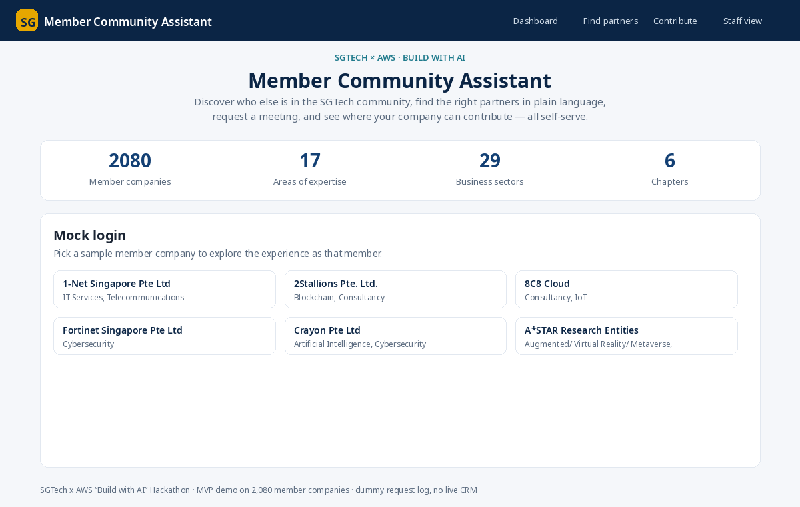
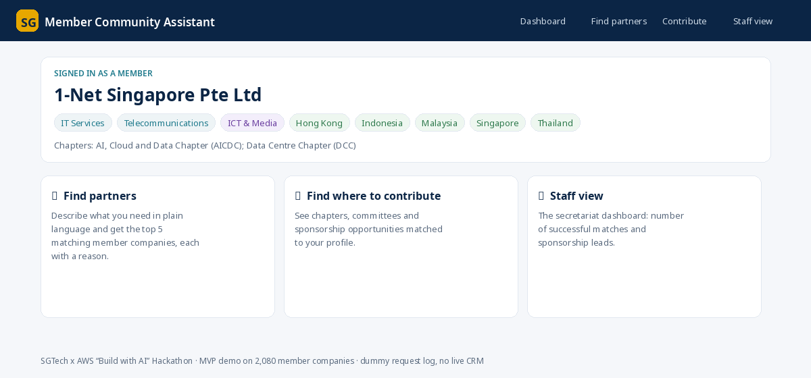
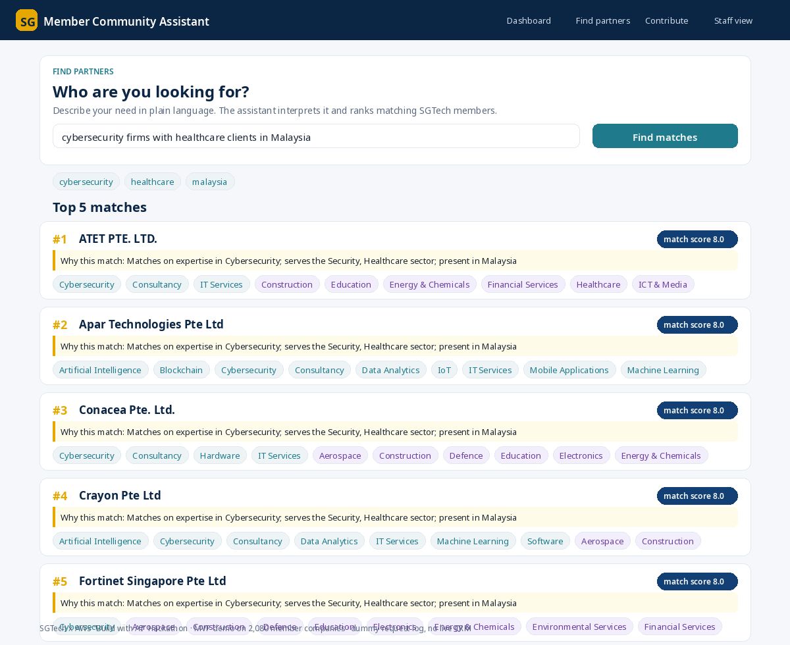
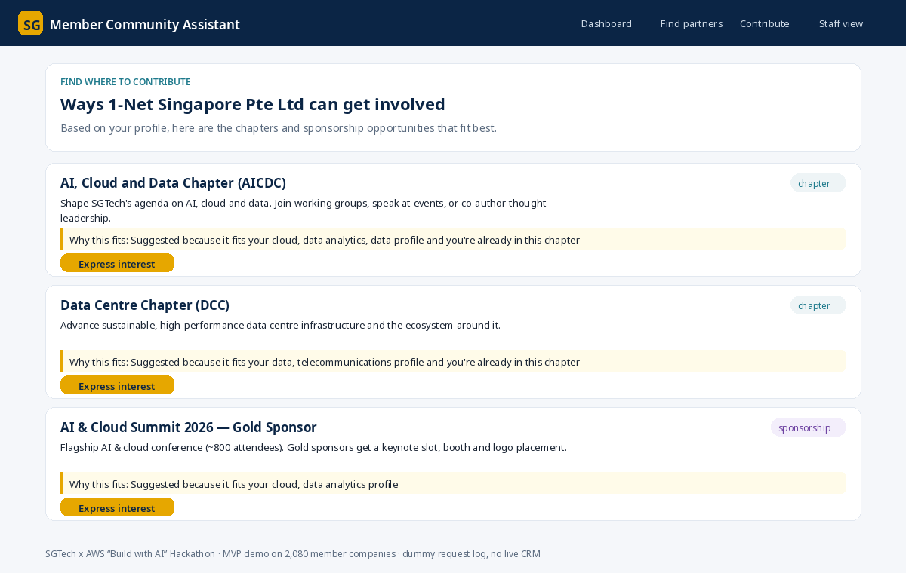
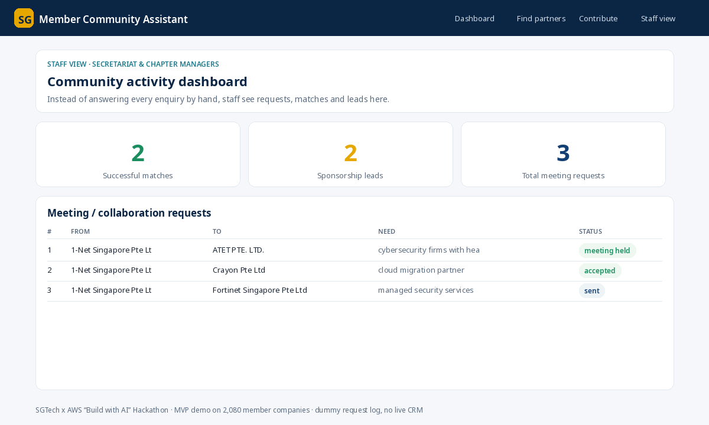

# SGTech Member Community Assistant (Hackathon MVP)

**SGTech × AWS "Build with AI" Hackathon — 22 October 2026**

An AI-powered Member Community Assistant that lets SGTech member companies
self-serve instead of emailing the secretariat:

1. **Mock login** as a sample member company.
2. **Find partners** — type a need in plain language (e.g. *"cybersecurity firms
   with healthcare clients"*) and get the **top 5 matching members**, each with a
   short **"why this match"** explanation.
3. **Request a meeting** — one click drafts a personalised meeting/collab message
   you can review and send. It's saved to a **request log** with a status.
4. **Find where to contribute** — ask *"Where can my company contribute?"* and get
   **3 suggested chapters / sponsorship opportunities** matched to your profile;
   click **Express interest** to log a **sponsorship lead**.
5. **Admin counter** — a staff dashboard showing the two success metrics:
   **# successful matches** and **# sponsorship leads**.

Built around the real **SGTech member directory** (2,080 companies) in
`input/members.csv`. No real CRM, auth, or email integration — everything is
logged in-app, matching the hackathon scope.

---

## Screenshots

> Previews of each screen, rendered from the **real member data and the actual
> matching-engine output**. (See `docs/screenshots/` for full-size images.)

**Home / mock login**


**Member dashboard**


**Find partners — ranked matches with "why this match"**


**Find where to contribute**


**Staff dashboard — the two success metrics**


---

## Run it in your browser — GitHub Codespaces (no install)

The fastest way to see the live app without installing anything:

1. On the repo page, click **Code ▸ Codespaces ▸ Create codespace on main**.
2. Wait ~1 minute while it builds (it auto-installs Flask).
3. In the Codespace terminal, run:
   ```bash
   python app.py
   ```
4. A toast pops up offering to open the forwarded **port 5000** — click
   **Open in Browser**. (Or open the **Ports** tab and click the 🌐 for port 5000.)

That's it — the live Member Community Assistant opens in a new browser tab.
Press **Ctrl+C** in the terminal to stop it.

> A `.devcontainer/` is included, so Codespaces sets up Python + dependencies
> and forwards port 5000 automatically.

---

## Run it locally

```bash
# macOS / Linux
bash run.sh

# Windows
run.bat
```

Then open **http://localhost:5000**. The scripts create a virtualenv, install
Flask, and start the server. See **[LOCAL_HOSTING.md](LOCAL_HOSTING.md)** for
prerequisites, options (custom port, auto-reload), and troubleshooting.

Manual equivalent:

```bash
python3 -m venv .venv
source .venv/bin/activate          # Windows: .venv\Scripts\activate
pip install -r requirements.txt
python app.py                      # -> http://localhost:5000
```

The request/lead log is written to `data/request_log.json` (created on first use).

---

## Demo walkthrough (2 minutes)

Follow this to show the whole value story end to end:

1. **Mock login** — on the home page, click a sample company, e.g.
   **1-Net Singapore Pte Ltd**. You land on that member's dashboard showing its
   expertise, sectors, countries and chapters.
2. **Find partners** — go to **Find partners** and type a need in plain English:
   > `cybersecurity firms with healthcare clients in Malaysia`

   The assistant shows how it **interpreted** your words (e.g. *cybersecurity,
   healthcare, malaysia*) and returns the **top 5 members**, each with a match
   score and a **"Why this match"** explanation.
3. **Request a meeting** — click **Request meeting** on a result. Review the
   **AI-drafted, editable** message, then **Send request**. You get a confirmation
   and the request is logged.
4. **Find where to contribute** — go to **Contribute**. See **3 chapters /
   sponsorship packages** matched to your profile, each with a reason. Click
   **Express interest** to log a sponsorship lead.
5. **Staff view** — go to **Staff view**. The dashboard shows the two success
   metrics — **# successful matches** and **# sponsorship leads** — plus a table
   of all requests. Change a request's status to **meeting held** and watch the
   "successful matches" number go up.

**More queries to try:** `AI and data analytics partners` ·
`fintech software company in Indonesia` · `IoT hardware manufacturer` ·
`cybersecurity firms for the government sector`.

**Verify without a browser:** `python3 test_app.py` → *18 passed, 0 failed*.

---

## How the matching works (explainable, no API keys)

The matching engine (`matcher.py`) is a transparent, keyword- and token-based
scorer — deliberately chosen so it runs offline with zero credentials and so every
result can be **explained** to the user (judges love this):

- The member's free-text need is tokenised and expanded with a small synonym map
  (e.g. *cyber → cybersecurity, security*; *fintech → financial services*).
- Each candidate company is scored on overlap with its `AreaOfExpertise`,
  `BusinessSector`, `CountriesWithPresence` and name, with weights.
- The top 5 are returned with a human-readable **"why this match"** string listing
  the specific overlapping signals.

The same engine powers the **contribution finder**, matching a member's profile to
SGTech chapters and sponsorship packages defined in `data/opportunities.json`.

---

## Project layout

```
app.py                  Flask web app (routes, session, admin dashboard)
matcher.py              Explainable matching engine (partners + contributions)
data_loader.py          Loads & normalises input/members.csv
data/opportunities.json Chapters, committees & sponsorship packages (dummy)
templates/              HTML pages
static/                 CSS
input/members.csv       Recovered SGTech member directory (2,080 companies)
```

## Scope / out of scope (per the worksheet)

- CSV dummy/real data only — **no live CRM** integration.
- **Mock login**, no SSO.
- Requests & leads are **logged in-app** — no real email/calendar sending.
- PDPA note: in production only opted-in members would be discoverable and contact
  details shown only after acceptance. Modelled as a flag, not enforced here.
